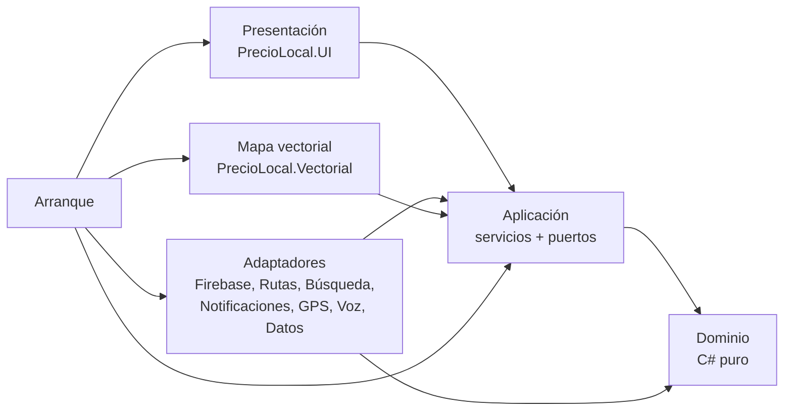
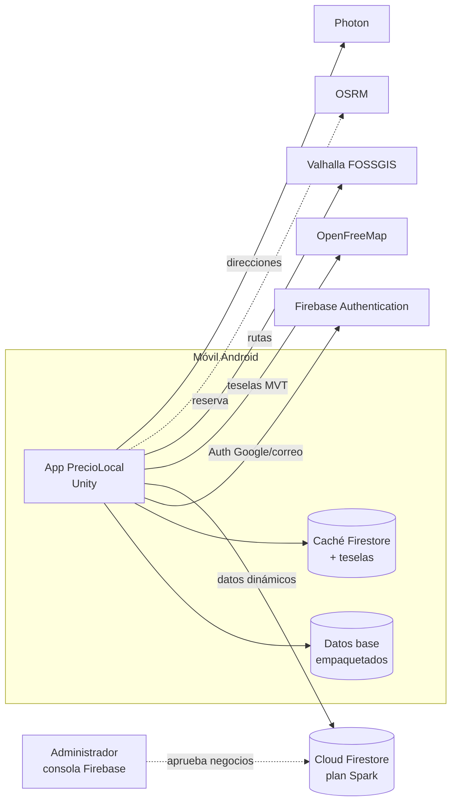
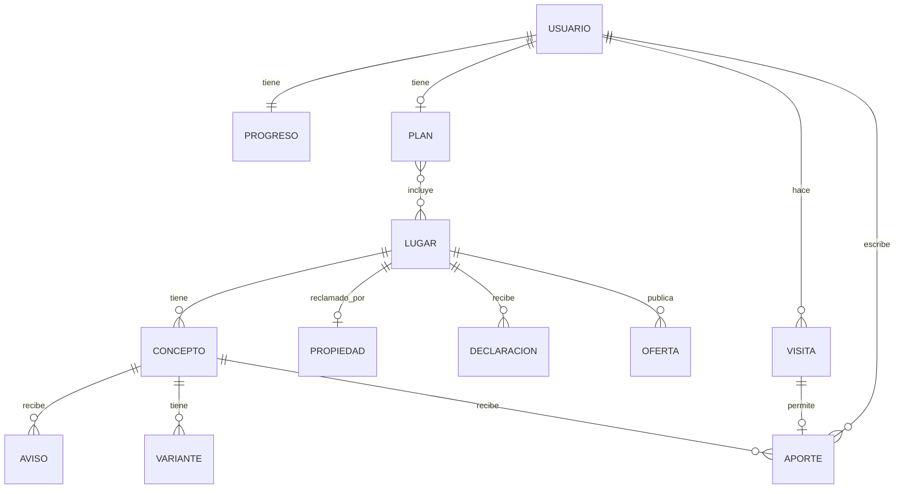

# Architecture Spine — PrecioLocal (app Android)

## Design Paradigm

**Hexagonal ligero (puertos y adaptadores).** Las reglas del producto viven en un núcleo de C# puro; todo lo externo (Firebase, rutas, búsqueda, mapa, GPS, notificaciones, voz) entra por interfaces; la interfaz solo muestra estado y envía comandos.

| Capa | Namespace / ensamblado (`.asmdef`) | Contiene |
|---|---|---|
| Dominio | `PrecioLocal.Dominio` (sin referencias a UnityEngine) | Entidades, reglas de precio, frescura, reputación, recompensas, plan, variantes; configuración de parámetros |
| Aplicación | `PrecioLocal.Aplicacion` | Casos de uso y servicios (visitas, aportes, cuentas, negocio, plan, búsqueda, navegación); **puertos** (interfaces) |
| Adaptadores | `PrecioLocal.Adaptadores.*` (`Firebase`, `Rutas`, `Busqueda`, `Notificaciones`, `Gps`, `Voz`, `Datos`) y `PrecioLocal.Vectorial` (mapa) | Implementaciones de los puertos con SDK y servicios externos |
| Presentación | `PrecioLocal.UI` | Pantallas de UI Toolkit, controladores de vista, tema |
| Arranque | `PrecioLocal.Arranque` | Raíz de composición: crea adaptadores y servicios y los entrega a la UI |



## Invariants & Rules

### AD-1 — Dirección de dependencias por capas [ADOPTED]

- **Binds:** all
- **Prevents:** reglas de negocio dentro de pantallas o adaptadores; la UI llamando a Firebase directamente.
- **Rule:** las dependencias siguen el diagrama de Design Paradigm y se imponen con `.asmdef`. `PrecioLocal.Dominio` tiene `noEngineReferences: true` y no referencia ningún otro ensamblado del proyecto. `PrecioLocal.UI` solo referencia Aplicación y Dominio, nunca un adaptador. Los adaptadores implementan puertos declarados en Aplicación.

### AD-2 — Una sola raíz de composición [ADOPTED]

- **Binds:** all
- **Prevents:** dos módulos creando su propia instancia de Firestore, del GPS o del mapa con estados distintos.
- **Rule:** solo `PrecioLocal.Arranque` crea adaptadores y servicios y los pasa por constructor o inicialización. Prohibidos los singletons y localizadores de servicios para lógica (`FirebaseFirestore.DefaultInstance` solo aparece dentro del adaptador de Firebase).

### AD-3 — El precio mostrado es derivado y nunca se guarda [ADOPTED]

- **Binds:** FR-8, FR-9, FR-31 a FR-35, FR-60
- **Prevents:** clientes que muestran precios distintos para el mismo concepto; escrituras de un precio calculado por un móvil desactualizado.
- **Rule:** el precio mostrado, su origen, la frescura y el estado "en revisión" los calcula `PrecioLocal.Dominio` en el momento de leer, a partir de: precio de la web (datos base), declaraciones del negocio, aportes y avisos. Ningún documento tiene un campo de precio calculado. El cálculo se hace por concepto y por variante.

### AD-4 — Aportes, avisos y visitas son inmutables [ADOPTED]

- **Binds:** FR-22 a FR-30, FR-34, FR-35, FR-59
- **Prevents:** historiales reescritos, recuentos de aportes que no cuadran entre clientes.
- **Rule:** estos documentos solo se crean; nunca se modifican ni se borran desde la app (salvo el borrado de cuenta, FR-42). Una corrección es un documento nuevo; la regla de "los más recientes" de AD-3 decide cuál cuenta.

### AD-5 — Un único dueño por dato compartido [ADOPTED]

- **Binds:** FR-36, FR-39, FR-43 a FR-47, NFR-8
- **Prevents:** dos escritores para la misma entidad; negocios editando datos de clientes o de otros negocios.
- **Rule:** cada entidad tiene un solo escritor:

| Entidad | Dónde vive | Escribe |
|---|---|---|
| Lugar base (OSM, tarifas web) | Datos empaquetados en la app | Nadie en ejecución (solo lectura) |
| Lugar dado de alta | Firestore `lugares` | El negocio que lo crea |
| Correo público de un lugar base (para verificar) | Firestore `contactosLugares/<id>` (solo lectura para la app) | El administrador, con el script de sembrado |
| Reclamación y verificación | Firestore `lugares/<id>/propiedad` | El negocio (solicitud); la regla la marca verificada si el correo coincide; si no, el administrador (aprobación manual) |
| Declaración de precios y variantes | Firestore `lugares/<id>/declaraciones` | El negocio verificado de ese lugar |
| Oferta | Firestore `lugares/<id>/ofertas` | El negocio verificado de ese lugar |
| Aporte público (sin autor) | Firestore `lugares/<id>/aportes` | El cliente autor, solo crear |
| Copia privada del aporte | Firestore `usuarios/<uid>/aportes` | El propio cliente |
| Aviso de precio incorrecto o de oferta (sin autor) | Firestore `lugares/<id>/avisos` | El cliente autor, solo crear |
| Visita verificada y pendiente | Firestore `usuarios/<uid>/visitas/<lugarId>_<AAAAMMDD>` | El propio cliente |
| Progreso (monedas, XP, reputación, compras, favoritos, plan, ajustes, insignias) | Firestore `usuarios/<uid>` | El propio usuario, siempre por campo (AD-18) |
| Eventos de evaluación (FR-59) | Firestore `evaluacion/<idAnonimo>/eventos` | El propio dispositivo, solo crear |

### AD-6 — Las reglas de Firestore son la frontera de seguridad [ADOPTED]

- **Binds:** NFR-8, FR-29, FR-30, FR-34, FR-39, §6.2 del PRD
- **Prevents:** que la app sea la única barrera; que alguien aporte sin visita o más de una vez al día; que un aporte público revele quién lo hizo.
- **Rule:** `firebase/firestore.rules`, versionado en el repositorio, impone AD-5 y además:
  - **Ningún aporte ni aviso público lleva uid ni dato del autor**, en ninguna categoría (cumple FR-30 de sobra).
  - La visita tiene id `<lugarId>_<AAAAMMDD>` en `usuarios/<uid>/visitas`: como mucho una por lugar y día.
  - Crear un aporte público exige, con `request.auth.uid`, que exista esa visita propia del mismo lugar, creada hace menos de 24 h y con `aporteHecho == false`. En el mismo lote se marca `aporteHecho = true` y se escribe la copia privada (la regla lo comprueba con `getAfter`).
  - El `peso` de un aviso debe coincidir con la reputación guardada en el progreso del autor.
  - Una cuenta de negocio no puede crear visitas, aportes ni avisos.
  - Un negocio solo escribe declaraciones y ofertas si `propiedad.verificado == true` y su uid es el dueño. `verificado` lo pone la regla solo si el correo verificado de su cuenta coincide con `contactosLugares/<id>.email`; en otro caso solo el administrador desde la consola.

### AD-7 — Firebase en plan Spark, sin código en servidor [ADOPTED]

- **Binds:** NFR-7, FR-12, FR-31 a FR-35, FR-43
- **Prevents:** funciones que dependan de Cloud Functions, SMS o push de servidor, que no existen en este plan.
- **Rule:** se usan solo Firebase Authentication (Google y correo) y Cloud Firestore. Todo cálculo ocurre en el cliente (AD-3). La verificación del negocio usa el correo del establecimiento (enlace de verificación de Firebase Auth comparado con `contactosLugares`, AD-6) y, si no hay correo público, aprobación manual del administrador. "Avísame si cambia" se comprueba en el cliente y avisa con notificación local.

### AD-8 — Firestore es el almacén local sin conexión [ADOPTED]

- **Binds:** NFR-2, FR-36, FR-40
- **Prevents:** una segunda base de datos local que se desincronice de Firestore.
- **Rule:** la persistencia sin conexión de Firestore está activada y es la única caché de datos del cliente; las escrituras sin conexión se encolan y la UI las muestra al momento. La única caché propia es la de teselas del mapa (`persistentDataPath/vectorial`).

### AD-9 — Ciclo de la visita verificada en un solo servicio

- **Binds:** FR-22 a FR-24, FR-29
- **Prevents:** que la navegación, las notificaciones y la pregunta creen o descarten visitas cada una a su manera.
- **Rule:** solo `ServicioVisitas` (Aplicación) crea una visita (cuando el tiempo restante de una ruta iniciada con la app hacia un lugar con precios llega a 5 min o menos), programa la notificación local de +1 h con el id de la visita, la pasa a pendiente y la cierra al responder. Los demás módulos le envían eventos (`RutaIniciada`, `TiempoRestanteCambiado`, `NotificacionAbierta`) y no tocan visitas.

### AD-10 — Importes en céntimos enteros

- **Binds:** FR-8, FR-25, FR-31, FR-46, FR-55, FR-60, NFR-6
- **Prevents:** errores de redondeo (22,50 € frente a 22,5) y comparaciones de igualdad fallidas.
- **Rule:** todo importe es un `int` de céntimos en Dominio, Aplicación y Firestore. Solo la Presentación lo formatea en es-ES (`40 €`, `22,50 €`). Los tramos de hostelería se guardan como rango `[minCent, maxCent]`, con `maxCent = null` en "Más de 50 €".

### AD-11 — Identificadores estables en texto

- **Binds:** FR-11, FR-44, FR-60
- **Prevents:** dos formatos de id para el mismo lugar y referencias rotas entre datos empaquetados y Firestore.
- **Rule:** lugar base `osm:<tipo>:<id>` o slug manual (`clinica-areas`, `chemabarber`); lugar dado de alta `alta:<autoId>`; concepto y variante con slug único dentro de su lugar (`fisioterapia/sesion`, `superinductiva@con-bono`). Los documentos de Firestore usan estos ids como clave. Un id de lugar base nunca se reutiliza ni se borra: si el lugar desaparece en una versión nueva de los datos, se marca como cerrado.

### AD-12 — Tiempo del servidor para los datos

- **Binds:** FR-32, FR-33, FR-46
- **Prevents:** frescuras y ventanas de 6 meses calculadas con relojes de móviles distintos.
- **Rule:** todo documento creado lleva `creado = ServerTimestamp`. Las funciones del Dominio reciben "ahora" como parámetro y nunca leen el reloj. Aplicación les pasa la hora del servidor estimada (hora local + desfase medido en la última lectura de Firestore) o, si nunca ha habido conexión, la hora local. La hora local sin corregir solo se usa para programar notificaciones.

### AD-13 — El mapa se usa solo a través de IMapa [ADOPTED]

- **Binds:** FR-1 a FR-6, FR-17, FR-18 a FR-20
- **Prevents:** pantallas que crean `GameObject` en el mapa o mezclan coordenadas de Unity con latitud y longitud.
- **Rule:** `PrecioLocal.Vectorial` es el único renderizador del mapa e implementa el puerto `IMapa` (tema, marcadores, ruta, posición, centrar, eventos de toque y pulsación larga). Dominio y Aplicación usan latitud/longitud en `double`; `Vector3` solo existe dentro del adaptador del mapa (vía `Geo`).

### AD-14 — Parámetros de negocio en un solo sitio

- **Binds:** FR-31 a FR-35, FR-48 a FR-52
- **Prevents:** el mismo umbral repetido con valores distintos en varios módulos.
- **Rule:** los parámetros (3 aportes, 6 meses, umbrales de frescura, pesos de reputación, recompensas, 150 XP por nivel, 3 avisos, 24 h) viven en una única clase `ParametrosNegocio` del Dominio. Nadie más declara esas constantes.

### AD-15 — La UI observa estado; no consulta datos

- **Binds:** todas las pantallas de EXPERIENCE.md
- **Prevents:** dos pantallas que muestran estados distintos del mismo lugar o del progreso.
- **Rule:** los servicios de Aplicación exponen estado y eventos (C# `event` o `IObservable`); la UI se suscribe y envía comandos. La UI no lee Firestore ni ficheros, y no guarda copias propias del estado de negocio.

### AD-16 — Un único registro de evaluación

- **Binds:** FR-59, SM-1 a SM-5
- **Prevents:** métricas incompletas o con datos personales repartidos por módulos.
- **Rule:** todo evento de evaluación pasa por el puerto `IRegistroEventos` con un id anónimo por instalación, sin uid ni ubicación exacta, y solo si el usuario dio su consentimiento. Nombres de eventos en `snake_case` de una lista cerrada (`visita_verificada`, `pregunta_respondida`, `pregunta_aplazada`, `aporte_creado`, `confirmacion`, `compra_tienda`).

### AD-17 — Forma fija del aporte y del aviso

- **Binds:** FR-24 a FR-27, FR-31 a FR-35, FR-60
- **Prevents:** que dos módulos guarden la variante o el tramo de forma distinta y el cálculo de AD-3 dé resultados diferentes.
- **Rule:** un aporte público tiene exactamente: `lugarId`, `conceptoId` (con la variante tras `@`, AD-11), `forma` (`fijo` | `tramo`), `importeCent` (si `fijo`) o `minCent` + `maxCent` (si `tramo`, `maxCent` nulo en "Más de 50 €"), `creado`. Un aviso tiene: `lugarId`, `conceptoId` (o `oferta:<ofertaId>`), `tipo` (`cambio` | `sin_servicio` | `cerrado` | `oferta_caducada`), `peso`, `creado`. Ningún otro campo, y nunca el autor (AD-6).

### AD-18 — El progreso del usuario se escribe por campo

- **Binds:** FR-40, FR-48 a FR-52, FR-54, FR-57, FR-58
- **Prevents:** que dos servicios que escriben el mismo documento de usuario se pisen los cambios (por ejemplo, el plan y las monedas).
- **Rule:** el documento `usuarios/<uid>` solo se modifica con actualizaciones por campo (merge); monedas y XP con incremento atómico. Prohibido sobrescribir el documento completo. Cada servicio escribe solo sus campos: `ServicioProgreso` (monedas, XP, reputación, insignias, compras y cosméticos equipados), `ServicioPlan` (plan), `ServicioCuentas` (ajustes, tipo de cuenta), `ServicioLugares` (favoritos y avisos activados).

### AD-19 — GPS en segundo plano solo durante una ruta, con servicio nativo

- **Binds:** NFR-3, FR-19, FR-20, FR-22, FR-56
- **Prevents:** que la visita verificada no se cree con la pantalla apagada; que otro módulo arranque el GPS en segundo plano sin ruta (seguimiento no consentido).
- **Rule:** la ubicación con la app en segundo plano la da un **servicio en primer plano de Android** (plugin nativo en `Assets/Plugins/Android/`, `android:foregroundServiceType="location"`, permiso `FOREGROUND_SERVICE_LOCATION`) que muestra una notificación fija de navegación. Lo arranca y lo para solo el adaptador de GPS, a petición del servicio de navegación: se arranca al pulsar Ir (con la app delante, así basta el permiso de ubicación normal; **no se pide `ACCESS_BACKGROUND_LOCATION`**) y se para al terminar la ruta o al cerrarse sola. Sin ruta activa, ningún módulo puede usar la ubicación en segundo plano. Las posiciones del servicio llegan al dominio por el mismo puerto de GPS que en primer plano.

## Consistency Conventions

| Concern | Convention |
|---|---|
| Idioma del código | Identificadores, clases y comentarios en castellano (como el código existente); sin tildes en identificadores (`Aplicacion`, `ServicioVisitas`) |
| Nombres | Servicios `Servicio<Algo>`; puertos `I<Algo>` en Aplicación; adaptadores `<Tecnologia><Puerto>` (`FirestoreAportes`); pantallas `Pantalla<Algo>` con su `.uxml` y `.uss` del mismo nombre |
| Ficheros | Un tipo público por fichero; carpetas = namespaces bajo `Assets/Scripts/` |
| Datos en Firestore | Colecciones en plural y minúsculas (`lugares`, `aportes`); campos en `camelCase` castellano (`conceptoId`, `importeCent`, `creado`) |
| Errores | Los puertos devuelven `Resultado<T>` (éxito o error con código); no se lanzan excepciones a través de capas; la UI traduce el código a texto (EXPERIENCE.md · Voice and Tone) |
| Asincronía | `Task`/`async` en Aplicación y adaptadores; vuelta al hilo principal solo en Presentación |
| Registro técnico | `Debug.Log` con prefijo `PrecioLocal:` solo en adaptadores y arranque; nunca datos personales |
| Tema y estilo | Colores y medidas solo desde los tokens de DESIGN.md, traducidos a variables USS; nada de colores sueltos en el código |
| Textos | Todos los textos visibles en tablas del paquete Localization de Unity (NFR-5), con `es-ES` como única locale de la v1; el código usa claves |
| Pruebas | Unity Test Framework: el Dominio con pruebas EditMode; cada regla de AD-3 y AD-14 con su prueba |
| Accesibilidad | El módulo de accesibilidad de Unity 6 no se rellena solo desde UI Toolkit: cada pantalla construye su `AccessibilityHierarchy` con etiqueta, rol y estado de cada control para TalkBack, y ofrece alternativa sin arrastre (EXPERIENCE.md · Accessibility Floor) |
| GPS y batería | Con la app delante, el adaptador de GPS usa la ubicación de Unity; durante una ruta, también el servicio en primer plano de AD-19. Sin ruta y con la app en segundo plano, GPS apagado (NFR-3) |

## Stack

| Name | Version |
|---|---|
| Unity (render integrado) | 6000.3.28f1 (6.3 LTS) |
| UI Toolkit | Integrado en Unity 6.3 |
| Firebase Unity SDK (Auth, Firestore) | 14.1.0 (confirmar en el registro oficial al instalar) |
| Mobile Notifications (`com.unity.mobile.notifications`) | 2.3.2 (o la última compatible con 6.3 en el gestor de paquetes) |
| Localization (`com.unity.localization`) | La que ofrezca el gestor de paquetes de 6.3 al instalar |
| Input System (modo "Both") | Paquete instalado en el proyecto |
| Unity Test Framework | Paquete del editor 6.3 |
| Android | minSdk 26, targetSdk 35 |
| Teselas vectoriales | OpenFreeMap (`tiles.openfreemap.org/planet`, MVT zoom 14) |
| Rutas | Valhalla (FOSSGIS, `shortest`) · OSRM (reserva) |
| Geocodificación | Photon (komoot) |

## Structural Seed





**Entornos y despliegue:** un único proyecto de Firebase para el TFG. Las reglas de Firestore están en `firebase/firestore.rules` y se despliegan con Firebase CLI. La colección `contactosLugares` se siembra con un script del administrador versionado en `firebase/sembrar/` a partir de los datos base. La app se distribuye como APK instalada a mano o con Firebase App Distribution, sin Google Play.

```text
unity/PrecioLocal/
  Assets/
    Scripts/
      Dominio/            # PrecioLocal.Dominio (sin UnityEngine)
      Aplicacion/         # servicios + puertos
      Adaptadores/        # Firebase, Rutas, Busqueda, Notificaciones, Gps, Voz, Datos
      Vectorial/          # mapa (existente): LectorMVT, Triangulador, MapaVectorial
      UI/                 # pantallas UI Toolkit (.cs + .uxml + .uss)
      Arranque/           # raíz de composición
    Datos/                # lugares base empaquetados (JSON)
    Plugins/Android/      # servicio de ubicación en primer plano (AD-19)
    Shaders/              # PlanoPaleta, edificios
    Tests/EditMode/       # pruebas del Dominio
firebase/
  firestore.rules
  sembrar/              # script del administrador: contactosLugares
```

## Capability → Architecture Map

| Capability / Area | Lives in | Governed by |
|---|---|---|
| 4.1 Mapa y descubrimiento (FR-1 a FR-6) | `Vectorial` + `UI` | AD-13, AD-15 |
| 4.2 Ficha y modelo de precios (FR-7 a FR-12, FR-60) | `Dominio` (reglas) + `Adaptadores.Datos` + `UI` | AD-3, AD-10, AD-11 |
| 4.3 Búsqueda y destinos (FR-13 a FR-17) | `Aplicacion` + `Adaptadores.Busqueda` | AD-1, AD-15 |
| 4.4 Navegación GPS (FR-18 a FR-22) | `Aplicacion` + `Adaptadores.Rutas`, `Gps` (+ plugin Android), `Voz` | AD-9, AD-13, AD-19 |
| 4.5 Pregunta de llegada y aportes (FR-23 a FR-30) | `ServicioVisitas`, `ServicioAportes` + `Adaptadores.Notificaciones`, `Firebase` | AD-4, AD-6, AD-9, AD-17 |
| 4.6 Reglas del precio y fiabilidad (FR-31 a FR-36) | `Dominio` | AD-3, AD-12, AD-14 |
| 4.7 Cuentas e identidad (FR-37 a FR-42) | `ServicioCuentas` + `Adaptadores.Firebase` | AD-5, AD-6, AD-7 |
| 4.8 Gestión del negocio (FR-43 a FR-47) | `ServicioNegocio` + `Adaptadores.Firebase` | AD-5, AD-6, AD-7 |
| 4.9 Gamificación (FR-48 a FR-53) | `Dominio` + `ServicioProgreso` | AD-5, AD-14, AD-18 |
| 4.10 Plan de tarde (FR-54 a FR-56) | `Dominio` + `ServicioPlan` | AD-10, AD-15 |
| 4.11 Perfil y ajustes (FR-57, FR-58) | `UI` + servicios | AD-15 |
| 4.12 Evaluación del TFG (FR-59) | `IRegistroEventos` + `Adaptadores.Firebase` | AD-16 |

## Deferred

- **Cloud Functions, push de servidor y SMS:** fuera mientras el proyecto siga en Spark (AD-7); se revisa si se pasa a Blaze.
- **Comprobación en segundo plano de "Avísame si cambia":** la v1 comprueba al abrir la app y al volver a primer plano.
- **Publicación en Google Play, iOS y CI/CD:** no hacen falta para el TFG.
- **Detalle de pantallas, estructura interna de cada servicio y esquema completo de campos:** los decide el código de cada historia dentro de estas reglas.
- **Moderación avanzada y panel web del administrador:** la aprobación manual se hace en la consola de Firebase.
- **Copias de seguridad de Firestore:** los exportes programados exigen Blaze; en el TFG se exportan a mano antes de las pruebas con usuarios si hace falta.
- **Monitorización de errores en producción:** no hay producción; el registro técnico local basta durante las pruebas.
- **Retirada de Cesium y de las escenas de prueba A y B:** se hace en la primera historia que toque el proyecto; quedan en la historia de la rama `unity`.
